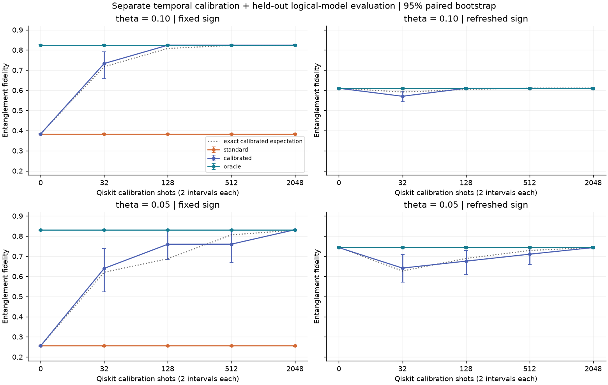

# Q3hack2026: temporal calibration for a Steane memory

**An executed Qiskit MVP for Qompute Track 3: Can We Trust a Noisy Quantum Computer?**

Team: Bells Pair.

Two coherent-noise models can produce the same syndrome-history distribution but
favor different final recoveries. We implement a Steane [[7,1,3]] memory with ideal
repeated X correction, learn temporal behavior from separate delayed-extraction
probes, and evaluate four final decoders on the same held-out records.

Start with the [executed report](results/REPORT.md), the [mathematical note](docs/math-note.md),
or the [executed end-to-end notebook](notebooks/mvp.ipynb).
For a guided reading, use the [code walkthrough](docs/code-walkthrough.md),
[noise and I/O guide](docs/noise-and-io.md), and
[hardware/workload connection](docs/hardware-workloads.md).

## Which noise is used?

**Both F and R have programmed coherent X rotations.** F keeps a common hidden
sign throughout a shot; R refreshes it each interval. Neither label means
noise-free. The main Aer simulations have no additional NoiseModel.

| Stage | Engine | Engineered rotations | Additional simulator noise |
|---|---|---|---|
| Ideal control | Qiskit Aer | theta = 0 | None |
| Short storage and bare control | Qiskit Aer | F or R | None |
| Separate calibration | Qiskit Aer | Two uninterrupted F/R intervals | None |
| Short sensitivity test | Qiskit Aer | F or R, T = 4 | 1% / 3% ancilla report flips only |
| Long storage comparison | Validated logical-model sampling | Ideal F/R conditional channels | No Aer execution or device noise |

Gate errors, relaxation, leakage, and crosstalk are not modeled. The sensitivity
test leaves calibration probes ideal. [Full definitions and array meanings](docs/noise-and-io.md).

## What actually ran

- Qiskit/Aer circuits with seven data qubits and one reusable ancilla: syndrome
  measurement, reset, and physical conditional correction for 0, 1, 2, and 4 cycles.
- All six logical Pauli inputs, zero-noise controls, every single-X fault,
  coherent branch-operator checks, bare memory, and imperfect syndrome reports.
- Independent Qiskit temporal calibration at 0, 32, 128, 512, and 2048 shots,
  with 24 independent batches at each budget/model/angle.
- Longer 128- and 929-cycle storage using the validated conditional logical model,
  with 4096 fresh evaluation records per batch. **These are classical calculations
  of the validated quantum model, not long Qiskit or hardware executions.**
- Standard, independence-assuming, calibrated, and distribution-oracle recovery.
  The oracle knows the distribution, never the realized signs.

The main run contains 731,136 Qiskit shots (storage, calibration, and bare controls)
and 393,216 unique logical-model evaluation records. There is no postselection.

## Main result

Known programmed angle; fixed-sign noise:

| theta | storage cycles | calibration shots per batch | standard Fe | observed calibrated Fe [95% bootstrap CI] | exact expected calibrated Fe |
|---:|---:|---:|---:|---:|---:|
| 0.10 | 128 | 512 | 0.3832 | 0.8238 [0.8203, 0.8275] | 0.822941 |
| 0.05 | 929 | 2048 | 0.2551 | 0.8314 [0.8283, 0.8345] | 0.829513 |

Fe is entanglement fidelity; the six-state mean is (2 Fe + 1)/3. Under independently
refreshed signs, the standard and independence-assuming decoder already match the
ideal oracle at these parameters. Finite calibration can hurt if it chooses the
wrong model. The confidence intervals are approximate, and the exact finite-shot
expectations are supplied to expose rare calibration errors missed by the batches.
For example, at theta=.1, T=128 and only 128 calibration shots, all 24 observed
batches happened to choose correctly: observed Fe=.8238 versus exact expected
Fe=.807603. The narrower empirical CI does not account for those unobserved mistakes.

The storage circuit is fixed across decoders. Final actions are destructive-readout
Pauli-frame updates. Calibration costs two noise intervals, 47 compiled CX operations,
three resets, and three measurements per shot. Full costs include the unoptimized
encoder and are reported as all-to-all simulator estimates, not QPU timings.

## Reproduce on Windows

Download or clone this repository, open a terminal, and change into its root directory.
Install Python 3.12 before running the commands below.
The tested environment is CPython 3.12.10, Qiskit 2.5.2, and Aer 0.17.2.

For a fresh environment (system Python is used only for the standard-library bootstrap):

~~~powershell
py -3.12 scripts/bootstrap_venv.py --install --locked
~~~

Every dependency and execution command thereafter uses the project interpreter:

~~~powershell
.\.venv\Scripts\python.exe -m pytest -q
.\.venv\Scripts\python.exe scripts/run_mvp.py
.\.venv\Scripts\python.exe scripts/execute_notebook.py
.\.venv\Scripts\python.exe -m pip check
~~~

The single run_mvp.py command regenerates all primary CSV/JSON tables, compressed
shot records, figures, and the report. Seeds, parameters, and software versions are recorded in
results/manifest.json. A smaller complete run is available:

~~~powershell
.\.venv\Scripts\python.exe scripts/run_mvp.py --quick --output results/smoke
~~~

The notebook executes the same pipeline with smaller budgets by default; change its
FULL_RUN flag to True for full statistics. execute_notebook.py installs its kernel
inside .venv, verifies that kernel's interpreter, and executes from a clean kernel.
No Jupyter server, IBM account, or Runtime dependency is needed.

The bootstrap command checks that the interpreter is in a virtualenv and runs
pip check after installation. No release validator or notebook builder is needed.
To work interactively in VS Code, open the supplied notebook and select this
repository's .venv interpreter as its kernel.

On macOS/Linux, use:

~~~sh
python3.12 scripts/bootstrap_venv.py --install --locked
.venv/bin/python scripts/run_mvp.py
.venv/bin/python scripts/execute_notebook.py
.venv/bin/python -m pytest -q
~~~

The lock was tested on Windows/Python 3.12. Other platforms may need a new
resolution using the bootstrap command with --install but without --locked.

## Files and evidence

| Location | Responsibility |
|---|---|
| src/q3hack/ | Encoder, quantum circuits, logical calculation, calibration, decoders, statistics, plots |
| tests/ | Quantum, algebraic, frame-equivalence, and information-boundary checks |
| notebooks/mvp.ipynb | Executed narrative and end-to-end pipeline |
| docs/math-note.md | Derivations, full-text citations, assumptions, and limitations |
| docs/mathematics.md | Compact mathematical construction and explicit-environment extension |
| docs/code-walkthrough.md | Functions, equations, shapes, and a worked syndrome example |
| docs/noise-and-io.md | Engine/noise matrix and input/output glossary |
| docs/hardware-workloads.md | Current hardware examples, SQD connection, and proposed validation path |
| results/REPORT.md | Measured/modeled results and Track 3 interpretation |
| results/README.md | Data dictionary and raw-record mapping |
| results/manifest.json | Runtime, versions, parameters, seeds, and execution accounting |
| requirements.in / requirements.lock.txt | Dependency inputs / tested resolution |
| references.bib | Academic bibliography |

## What the result supports

The known answer is preservation of an arbitrary logical qubit. The experiment shows
why matching a syndrome histogram need not establish that a decoder has enough
information, and measures the cost of an additional diagnostic. It also shows a
boundary: at 3% ancilla-report flips, short-circuit fidelity drops below the ideal
prediction. The model should earn trust through independent checks and held-out
outcomes, with those limits visible to anyone relying on the result.

This is an intentionally small, inspectable simulator study. Known angle, uniform
X rotations, ideal resets/gates, and two candidate temporal models are restrictive.
No general fault tolerance, hardware readiness, quantum-bath requirement, formal
non-Markovianity witness, or new theorem is claimed. Unknown-angle fitting, spectator
circuits, echo, twirling, and master equations remain extensions.

Researchers using noisy quantum results need to distinguish measurement uncertainty
from a wrong noise assumption. This experiment makes that distinction visible:
a narrow observed interval can miss rare calibration mistakes. Calibration also
uses extra shots and gates, so access to compute affects how much evidence a team
can collect. Reporting both uncertainty and cost helps others judge the strength
of a result without treating a simulator benchmark as a deployed capability.

Challenge context: [Qompute Track 3](https://github.com/sandraalhames/Qompute-2026).
